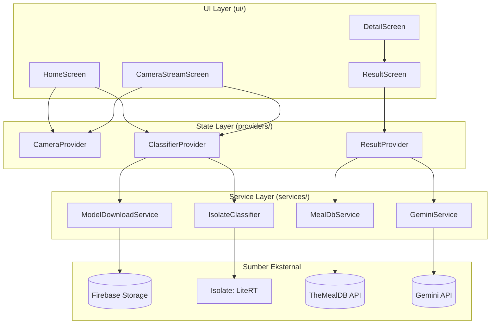
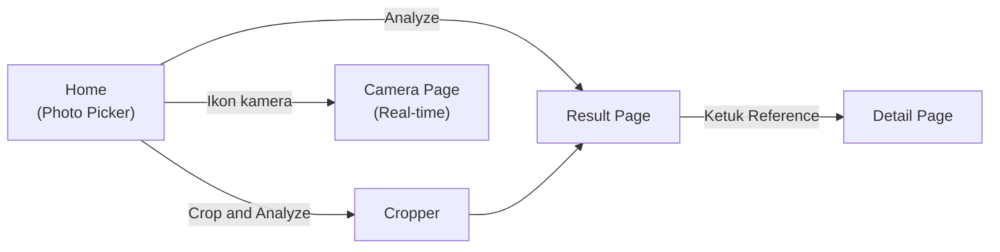
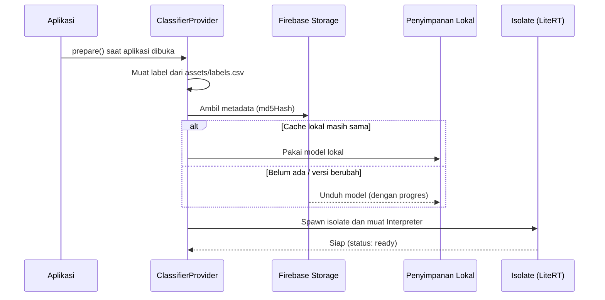

<div align="center">

# 🍽️ Food Recognizer App

**Aplikasi Flutter yang mengenali makanan dari foto atau kamera secara real-time menggunakan model machine learning (LiteRT), lalu menampilkan nutrisi dan resep referensi.**


</div>

---

## 📑 Daftar Isi

- [Tentang Proyek](#-tentang-proyek)
- [Tampilan Aplikasi](#-tampilan-aplikasi)
- [Fitur Utama](#-fitur-utama)
- [Teknologi dan Library](#-teknologi-dan-library)
- [Arsitektur Proyek](#-arsitektur-proyek)
- [Cara Kerja Machine Learning](#-cara-kerja-machine-learning)
- [Integrasi API Eksternal](#-integrasi-api-eksternal)
- [Konfigurasi Izin Akses](#-konfigurasi-izin-akses)
- [Cara Menjalankan Proyek](#-cara-menjalankan-proyek)
- [Pemecahan Masalah](#-pemecahan-masalah)
- [Batasan yang Perlu Diketahui](#-batasan-yang-perlu-diketahui)
- [Pemetaan Kriteria Submission](#-pemetaan-kriteria-submission)
- [Pengembang](#-pengembang)

---

## 📖 Tentang Proyek

**Food Recognizer App** adalah aplikasi mobile berbasis **Flutter** yang dibuat sebagai submission kelas *Belajar Penerapan Machine Learning untuk Flutter* (Dicoding). Pengguna cukup memilih foto makanan, memotongnya (crop), atau mengarahkan kamera ke makanan. Aplikasi lalu:

1. **Mengenali jenis makanan** dengan model klasifikasi gambar (LiteRT / TensorFlow Lite) yang dijalankan di *Isolate* terpisah sehingga UI tetap lancar.
2. **Menampilkan tingkat keyakinan** (*confidence score*) hasil prediksi dalam persentase.
3. **Memperkirakan nutrisi** (kalori, karbohidrat, lemak, serat, protein) lewat **Gemini API** dengan *structured output*.
4. **Menampilkan resep referensi** (bahan dan langkah pembuatan) dari **TheMealDB API**.

Model ML tidak disimpan di dalam aplikasi. Model **diunduh secara dinamis dari Firebase Cloud Storage** saat aplikasi pertama kali dibuka, lalu disimpan secara lokal agar dapat dipakai tanpa internet.

---

## 📸 Tampilan Aplikasi

> **Cara mengisi:** letakkan tangkapan layar di folder `docs/screenshots/` dengan nama file seperti pada tabel, atau ubah atribut `src` sesuai nama file Anda.

### Alur Utama

<table align="center">
  <tr>
    <th align="center">Photo Picker Page<br><sub>(Home)</sub></th>
    <th align="center">Cropping Page</th>
    <th align="center">Result Page</th>
    <th align="center">Detail Page</th>
  </tr>
  <tr>
    <td align="center">
      
    </td>
    <td align="center">
      
    </td>
    <td align="center">
      
    </td>
    <td align="center">
      
    </td>
  </tr>
  <tr>
    <td align="center"><sub>Pilih gambar dari galeri atau kamera, lalu tekan <b>Analyze</b> atau <b>Crop &amp; Analyze</b>.</sub></td>
    <td align="center"><sub>Potong bagian penting gambar dengan rasio Original, Square, atau 4×3.</sub></td>
    <td align="center"><sub>Nama makanan, confidence, Nutrition Facts, dan daftar Reference.</sub></td>
    <td align="center"><sub>Bahan (Ingredients) dan langkah pembuatan (Instructions) dari MealDB.</sub></td>
  </tr>
</table>

### Fitur Tambahan

<table align="center">
  <tr>
    <th align="center">Camera Page<br><sub>(Real-time)</sub></th>
    <th align="center">Unduh Model<br><sub>(Firebase Storage)</sub></th>
    <th align="center">Gambar Terpilih<br><sub>(Home)</sub></th>
    <th align="center">Penanganan Error</th>
  </tr>
  <tr>
    <td align="center">
      
    </td>
    <td align="center">
      
    </td>
    <td align="center">
      
    </td>
    <td align="center">
      
    </td>
  </tr>
  <tr>
    <td align="center"><sub>Preview live dengan hasil prediksi di bagian bawah.</sub></td>
    <td align="center"><sub>Progres pengunduhan model saat pertama kali membuka aplikasi.</sub></td>
    <td align="center"><sub>Pratinjau gambar yang dipilih sebelum dianalisis.</sub></td>
    <td align="center"><sub>Pesan error dan tombol <b>Coba Lagi</b> bila API gagal.</sub></td>
  </tr>
</table>

### Demo (Opsional)

<p align="center">
  <!-- Ganti dengan GIF atau tautan video demo Anda -->
  
</p>

---

## ✨ Fitur Utama

### 1. Pengambilan Gambar
- **Image Picker:** pilih gambar dari galeri atau ambil langsung dari kamera.
- **Image Cropper:** potong gambar (Original, Square, 4×3) sebelum dianalisis lewat tombol *Crop & Analyze*.
- **Camera Stream:** identifikasi makanan secara real-time dari *camera feed* memakai library `camera`.
- Penanganan gambar rusak (menampilkan ikon dan pesan, bukan crash).

### 2. Machine Learning
- Inferensi memakai **LiteRT** (`tflite_flutter`) dengan model Food Classification (input 224×224 RGB, 2023 kelas makanan).
- **Isolate terpisah:** *decode*, *resize*, dan inferensi berjalan di luar UI thread, sehingga UI tidak freeze.
- **Model dinamis dari Firebase Cloud Storage** dengan indikator progres, *caching* lokal, deteksi versi baru, dan cadangan lokal saat offline.
- Mendukung model berformat input/output **uint8** maupun **float32** secara otomatis.

### 3. Halaman Prediksi
- **Result Page:** foto, nama makanan, dan confidence (%).
- **Nutrition Facts** dari Gemini API: kalori, karbohidrat, lemak, serat, dan protein.
- **Reference** dari TheMealDB: daftar resep terkait, dengan halaman **Detail** berisi bahan dan langkah pembuatan.
- Setiap bagian punya status *loading*, *error*, dan tombol **Coba Lagi** yang berdiri sendiri.

### 4. Kualitas Kode
- State management **Provider** dengan pemisahan tanggung jawab yang jelas.
- Arsitektur berlapis: `core`, `models`, `services`, `providers`, `ui`.
- API Key **tidak disematkan** di kode (dibaca lewat `--dart-define`).
- Siklus hidup kamera dikelola (dilepas saat keluar halaman atau aplikasi masuk *background*).

---

## 🛠️ Teknologi dan Library

| Kategori | Teknologi / Library | Kegunaan |
|---|---|---|
| Framework | [Flutter](https://flutter.dev) 3.47 / Dart 3.13 | Pengembangan UI lintas platform |
| State Management | [`provider`](https://pub.dev/packages/provider) | Pengelolaan state aplikasi |
| Machine Learning | [`tflite_flutter`](https://pub.dev/packages/tflite_flutter) (LiteRT) | Menjalankan model `.tflite` di perangkat |
| Pemrosesan Gambar | [`image`](https://pub.dev/packages/image) | Decode, resize, rotasi, dan konversi frame |
| Kamera | [`camera`](https://pub.dev/packages/camera) | Live preview dan camera stream |
| Pengambilan Gambar | [`image_picker`](https://pub.dev/packages/image_picker) | Galeri dan kamera |
| Pemotongan Gambar | [`image_cropper`](https://pub.dev/packages/image_cropper) | Crop gambar (UCrop di Android) |
| Backend | [`firebase_core`](https://pub.dev/packages/firebase_core), [`firebase_storage`](https://pub.dev/packages/firebase_storage) | Inisialisasi Firebase dan penyimpanan model di cloud |
| Jaringan | [`http`](https://pub.dev/packages/http) | Memanggil MealDB dan Gemini REST API |
| Penyimpanan Lokal | [`path_provider`](https://pub.dev/packages/path_provider) | Lokasi penyimpanan model hasil unduhan |
| Generative AI | [Gemini API](https://ai.google.dev) | Estimasi nutrisi dengan *structured output* |
| API Resep | [TheMealDB](https://www.themealdb.com/api.php) | Data resep, bahan, dan langkah pembuatan |
| Dataset Model | Model *Food Classification* (Kaggle) | Klasifikasi 2023 jenis makanan |

---

## 🏗️ Arsitektur Proyek

### Struktur Folder

```
food_recognizer_app/
├── assets/
│   └── labels.csv                    # Labelmap model (satu label per baris)
├── lib/
│   ├── main.dart                     # Entry point, init Firebase, MultiProvider
│   ├── firebase_options.dart         # Dihasilkan FlutterFire CLI
│   ├── core/
│   │   ├── app_config.dart           # Konfigurasi: path model, URL API, model Gemini
│   │   ├── app_exception.dart        # Exception dengan pesan ramah pengguna
│   │   └── formatters.dart           # Format persen, gram, dan Title Case
│   ├── models/
│   │   ├── classification_result.dart
│   │   ├── nutrition_info.dart
│   │   └── meal.dart                 # Meal + Ingredient (parsing strIngredientX / strMeasureX)
│   ├── services/
│   │   ├── model_download_service.dart  # Unduh model dari Firebase Storage
│   │   ├── isolate_classifier.dart      # Isolate + inferensi LiteRT
│   │   ├── meal_db_service.dart         # Client TheMealDB
│   │   └── gemini_service.dart          # Client Gemini REST API
│   ├── providers/
│   │   ├── camera_provider.dart      # Kamera, stream, picker, cropper
│   │   ├── classifier_provider.dart  # Status model dan inferensi
│   │   └── result_provider.dart      # Nutrisi (Gemini) dan resep (MealDB)
│   └── ui/
│       ├── screens/
│       │   ├── home_screen.dart
│       │   ├── camera_stream_screen.dart
│       │   ├── result_screen.dart
│       │   └── detail_screen.dart
│       └── widgets/
│           └── section_header.dart
├── test/
│   └── widget_test.dart
├── storage.rules                     # Aturan Firebase Storage (read-only publik untuk /models)
├── pubspec.yaml
└── README.md
```

### Pola Arsitektur

Proyek memisahkan **UI**, **state**, dan **logika/akses data** ke dalam lapisan yang berbeda:



### Tanggung Jawab Provider

| Provider | Cakupan | Tanggung Jawab |
|---|---|---|
| `CameraProvider` | Global | Inisialisasi kamera, camera stream (start/stop), image picker, image cropper, dan hasil prediksi live |
| `ClassifierProvider` | Global | Memuat label, mengunduh model, memuat Isolate, dan menjalankan inferensi (gambar statis dan frame kamera) |
| `ResultProvider` | Per halaman (*scoped*) | Mengambil nutrisi dari Gemini dan resep dari MealDB secara paralel, lengkap dengan status *loading/success/error* |

### Alur Navigasi



---

## 🧠 Cara Kerja Machine Learning

### Siklus Hidup Model



### Alur Inferensi

| Sumber | Tahapan |
|---|---|
| **Gambar statis** | `File` → kirim path ke Isolate → decode (dengan perbaikan orientasi EXIF) → resize 224×224 → inferensi → hasil |
| **Camera stream** | `CameraImage` → salin bytes plane → Isolate → konversi YUV420/BGRA ke RGB (sambil di-*downsample* ke 224×224) → rotasi sesuai orientasi sensor → inferensi → hasil |

Detail penting:

- **Throttling:** frame kamera dianalisis maksimal sekali tiap **700 ms**, dan frame baru diabaikan selama inferensi sebelumnya belum selesai, sehingga tidak ada antrean yang menumpuk.
- **Adaptif terhadap format model:** tipe tensor input/output (uint8 atau float32) dibaca langsung dari model. Output uint8 dinormalisasi menjadi probabilitas 0–1.
- **Label:** header `name` diabaikan, baris `__background__` dilewati saat memilih prediksi teratas, dan label ditambah otomatis bila jumlahnya kurang satu dari jumlah output model.
- **Cache model:** model disimpan di folder dukungan aplikasi dan hanya diunduh ulang bila `md5Hash` di cloud berbeda. Bila gagal terhubung, model lokal yang ada tetap dipakai.
- **Cadangan Firebase Hosting:** bila `AppConfig.modelHostingUrl` diisi, aplikasi akan mengunduh dari URL tersebut saat Storage gagal.

---

## 🌐 Integrasi API Eksternal

### TheMealDB (Resep Referensi)

- Endpoint: `GET https://www.themealdb.com/api/json/v1/1/search.php?s={nama_makanan}`
- Tanpa API Key.
- Bila pencarian dengan nama lengkap tidak menemukan hasil, aplikasi mencoba kata kunci terpisah (maksimal 3 percobaan), lalu menampilkan hingga 10 hasil.
- Data yang dipakai: `strMeal`, `strMealThumb`, `strIngredient1..20`, `strMeasure1..20`, dan `strInstructions`.

### Gemini API (Nutrisi)

- Endpoint: `POST https://generativelanguage.googleapis.com/v1beta/models/{model}:generateContent`
- Autentikasi lewat header `x-goog-api-key`.
- Memakai **System Instruction** dan **Structured Output** (`responseMimeType: application/json` dengan `responseSchema`) agar hasil selalu berupa JSON berisi: `calories`, `carbohydrates`, `fat`, `fiber`, `protein`.
- Daftar model diatur di `AppConfig.geminiModels` dan dicoba berurutan; bila model menghasilkan **404**, aplikasi otomatis mencoba model berikutnya.

---

## 🔐 Konfigurasi Izin Akses

### Android

File: `android/app/src/main/AndroidManifest.xml`

```xml
<manifest xmlns:android="http://schemas.android.com/apk/res/android">

    <!-- Wajib: Firebase, MealDB, dan Gemini membutuhkan internet -->
    <uses-permission android:name="android.permission.INTERNET"/>
    <!-- Wajib: live preview dan camera stream -->
    <uses-permission android:name="android.permission.CAMERA"/>

    <application ...>
        <activity android:name=".MainActivity" ...>
            ...
        </activity>

        <!-- Wajib untuk image_cropper. Letakkan SEJAJAR dengan MainActivity,
             bukan di dalamnya. -->
        <activity
            android:name="com.yalantis.ucrop.UCropActivity"
            android:screenOrientation="portrait"
            android:theme="@style/Theme.AppCompat.Light.NoActionBar"/>

        <meta-data android:name="flutterEmbedding" android:value="2" />
    </application>
</manifest>
```

| Izin / Komponen | Alasan |
|---|---|
| `INTERNET` | Mengunduh model, memanggil MealDB dan Gemini, memuat gambar resep. Tanpa ini, build **release** tidak dapat mengakses jaringan. |
| `CAMERA` | Camera Page dan pengambilan foto lewat kamera. |
| `UCropActivity` | Layar pemotongan gambar dari library `image_cropper`. |

> Pemilihan gambar dari galeri memakai pemilih bawaan sistem lewat `image_picker`, sehingga umumnya tidak memerlukan izin penyimpanan tambahan pada Android modern.

### iOS (opsional, belum diuji)

File: `ios/Runner/Info.plist`

```xml
<key>NSCameraUsageDescription</key>
<string>Kamera digunakan untuk mengenali makanan.</string>
<key>NSPhotoLibraryUsageDescription</key>
<string>Galeri digunakan untuk memilih gambar makanan.</string>
```

### Izin saat aplikasi berjalan

Izin kamera diminta otomatis oleh plugin saat pertama kali kamera dipakai. Bila ditolak, aplikasi menampilkan pesan dan tombol **Coba Lagi**.

---

## 🚀 Cara Menjalankan Proyek

### Prasyarat

| Kebutuhan | Keterangan |
|---|---|
| Flutter SDK | 3.47.x (Dart 3.13.x) atau yang kompatibel |
| Android Studio | Dengan Android SDK dan emulator, atau perangkat Android fisik |
| Akun Firebase | Untuk Cloud Storage dan konfigurasi `firebase_options.dart` |
| Akun Google AI Studio | Untuk mendapatkan Gemini API Key |
| Model dan label | Model `.tflite` Food Classification dan labelmap-nya |

### 1. Clone repository

```bash
git clone https://github.com/USERNAME_ANDA/food_recognizer_app.git
cd food_recognizer_app
```

### 2. Pasang dependensi

```bash
flutter pub get
```

### 3. Siapkan Firebase

1. Buat proyek di [Firebase Console](https://console.firebase.google.com) dan daftarkan aplikasi Android.
2. Hubungkan proyek dengan FlutterFire CLI (akan membuat `lib/firebase_options.dart` dan `google-services.json`):
   ```bash
   dart pub global activate flutterfire_cli
   flutterfire configure
   ```
3. Aktifkan **Storage** (**Build → Storage → Get started**).
4. Unggah model `.tflite` ke path persis berikut dan beri nama **`food_classifier.tflite`**:
   ```
   models/food_classifier.tflite
   ```
5. Di tab **Rules**, tempel isi berkas [`storage.rules`](storage.rules) lalu **Publish**:
   ```
   rules_version = '2';
   service firebase.storage {
     match /b/{bucket}/o {
       match /models/{allPaths=**} {
         allow read: if true;
         allow write: if false;
       }
     }
   }
   ```

> Proyek Firebase baru terkadang meminta paket **Blaze** untuk membuat bucket Storage. Alternatifnya, host model lewat **Firebase Hosting** dan isi `AppConfig.modelHostingUrl` di `lib/core/app_config.dart`.

### 4. Siapkan label

Letakkan labelmap model di `assets/labels.csv` (satu nama makanan per baris, urutan **tidak boleh diubah** karena harus sama dengan urutan output model).

### 5. Dapatkan Gemini API Key

Buat key di [Google AI Studio](https://aistudio.google.com/apikey). **Jangan** menulis key ke dalam kode atau commit ke repository.

### 6. Konfigurasi Android

Pastikan `AndroidManifest.xml` sesuai bagian [Konfigurasi Izin Akses](#-konfigurasi-izin-akses). Bila build gagal dengan pesan *Inconsistent JVM-target compatibility*, lihat bagian [Pemecahan Masalah](#-pemecahan-masalah).

### 7. Jalankan aplikasi

```bash
flutter run --dart-define=GEMINI_API_KEY=KEY_ANDA
```

> ⚠️ Tulis tanpa spasi setelah tanda `=`.

Di **Android Studio**: *Run → Edit Configurations → Additional run args* → `--dart-define=GEMINI_API_KEY=KEY_ANDA`.

Tanpa key, seluruh fitur tetap berjalan kecuali **Nutrition Facts**, yang akan menampilkan pesan bahwa key belum diatur.

### 8. Build APK (opsional)

```bash
flutter build apk --release --dart-define=GEMINI_API_KEY=KEY_ANDA
```

### Uji Cepat

| # | Skenario | Hasil yang diharapkan |
|---|---|---|
| 1 | Buka aplikasi pertama kali | Banner "Mengunduh model..." muncul lalu hilang |
| 2 | Pilih gambar lalu **Analyze** | Result Page: foto, nama, confidence, nutrisi, referensi |
| 3 | **Crop & Analyze** | Cropper terbuka, hasil crop dianalisis |
| 4 | Ikon kamera di App Bar | Preview live dengan prediksi di bagian bawah |
| 5 | Ketuk item Reference | Detail Page: bahan dan langkah pembuatan |
| 6 | Matikan internet lalu buka ulang | Model lokal tetap dipakai |

Menjalankan tes unit bawaan:

```bash
flutter test
flutter analyze
```

---

## 🧯 Pemecahan Masalah

| Gejala | Penyebab | Solusi |
|---|---|---|
| `Inconsistent JVM-target compatibility ... (11) and ... (25)` | Plugin `tflite_flutter` memakai Java 11, sedangkan Kotlin mengikuti JDK yang menjalankan Gradle | Tambahkan blok di bawah ke `android/build.gradle.kts` (sebelum blok `evaluationDependsOn`) |
| `AAPT: error: unexpected element <activity> found in <manifest><application><activity>` | `UCropActivity` tertulis di dalam `MainActivity` atau terduplikasi | Letakkan `UCropActivity` **sejajar** dengan `MainActivity`, hanya satu kali |
| Nutrisi: `Gemini ... (404)` | Model Gemini tidak tersedia untuk akun Anda | Perbarui daftar `geminiModels` di `lib/core/app_config.dart` dengan model yang tersedia di AI Studio |
| Nutrisi: `(429)` | Kuota Gemini habis | Tunggu sebentar lalu tekan **Coba Lagi** |
| Nutrisi: `(400)` / `(403)` | API Key salah atau tidak terbaca | Periksa `--dart-define`, pastikan tidak ada spasi setelah `=` |
| "Berkas label tidak ditemukan" | `assets/labels.csv` belum ada atau `assets/` belum terdaftar | Tambahkan berkas dan pastikan `pubspec.yaml` memuat `assets/` |
| "Gagal mengunduh model" | Berkas belum diunggah, path salah, atau Rules belum mengizinkan baca | Periksa path `models/food_classifier.tflite` dan Rules Storage |
| Nama makanan tidak masuk akal | Urutan/jumlah label tidak cocok dengan output model | Gunakan labelmap asli tanpa diubah |
| Build iOS gagal | Belum diuji; butuh Xcode 16+ dan CocoaPods | Gunakan Android, atau siapkan toolchain iOS |

**Perbaikan JVM target** (`android/build.gradle.kts`):

```kotlin
subprojects {
    afterEvaluate {
        extensions.findByType(com.android.build.gradle.BaseExtension::class.java)?.apply {
            compileOptions {
                sourceCompatibility = JavaVersion.VERSION_17
                targetCompatibility = JavaVersion.VERSION_17
            }
        }
    }
    tasks.withType<org.jetbrains.kotlin.gradle.tasks.KotlinCompile>().configureEach {
        compilerOptions {
            jvmTarget.set(org.jetbrains.kotlin.gradle.dsl.JvmTarget.JVM_17)
        }
    }
}
```

---

## ⚠️ Batasan yang Perlu Diketahui

- Model hanya mengenali **kelas makanan** yang dikenalnya. Model tidak dapat membedakan gambar non-makanan, menentukan layak-tidaknya dimakan, memperkirakan bahan, atau menghitung nutrisi.
- **Nutrisi adalah estimasi** dari model bahasa Gemini, bukan hasil uji laboratorium. Gunakan sebagai gambaran, bukan acuan medis atau diet.
- **Resep referensi** berdasarkan pencarian nama di TheMealDB, sehingga bisa tidak ada, atau berbeda dari makanan pada foto.
- Kecepatan prediksi live bergantung pada perangkat (dibatasi sekitar satu frame per 700 ms).
- Nama model Gemini dapat berubah atau dipensiunkan oleh Google. Sesuaikan `AppConfig.geminiModels` bila perlu.
- Aplikasi **diuji pada Android**. Dukungan iOS belum diverifikasi.

---

## ✅ Pemetaan Kriteria Submission

| Kriteria | Implementasi |
|---|---|
| **1. Pengambilan Gambar** | `image_picker` (galeri/kamera), preview gambar di Home, `image_cropper` (*Crop & Analyze*), dan identifikasi real-time lewat `camera` |
| **2. Machine Learning** | Model Food Classification dengan LiteRT (`tflite_flutter`), inferensi di **Isolate**, model diunduh dinamis dari **Firebase Cloud Storage** |
| **3. Halaman Prediksi** | Result Page (foto, nama, confidence), referensi **MealDB** (nama, foto, bahan, langkah), dan nutrisi dari **Gemini API** |

---

## 🔒 Keamanan

- **Jangan** meng-commit API Key. Key Gemini dibaca lewat `--dart-define` saat dijalankan.
- Aturan Storage hanya mengizinkan **baca** pada folder `models/` dan menolak semua penulisan dari klien.
- Bila repository bersifat publik, pertimbangkan membatasi API Key Firebase di Google Cloud Console dan menambahkan `google-services.json` serta `firebase_options.dart` ke `.gitignore`.
- Bila key tidak sengaja ter-commit atau terbagikan, segera **hapus dan buat key baru** di Google AI Studio.

---

## 👤 Pengembang

<table>
  <tr>
    <td align="center">
      <br>
      <b>Nama Anda</b><br>
      <a href="https://github.com/USERNAME_ANDA">@USERNAME_ANDA</a>
    </td>
  </tr>
</table>

Proyek ini dibuat untuk memenuhi submission kelas **Belajar Penerapan Machine Learning untuk Flutter** di [Dicoding](https://www.dicoding.com).

---

## 🙏 Referensi dan Kredit

- [Flutter](https://flutter.dev) dan [Provider](https://pub.dev/packages/provider)
- [LiteRT / TensorFlow Lite untuk Flutter](https://pub.dev/packages/tflite_flutter)
- [Firebase Cloud Storage](https://firebase.google.com/docs/storage)
- [TheMealDB](https://www.themealdb.com/api.php)
- [Gemini API](https://ai.google.dev/gemini-api/docs)
- Model Food Classification dan materi kelas oleh [Dicoding](https://www.dicoding.com)

<div align="center">

⭐ Jika proyek ini bermanfaat, jangan lupa beri bintang pada repository ini.

</div>